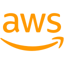
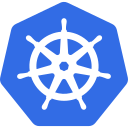
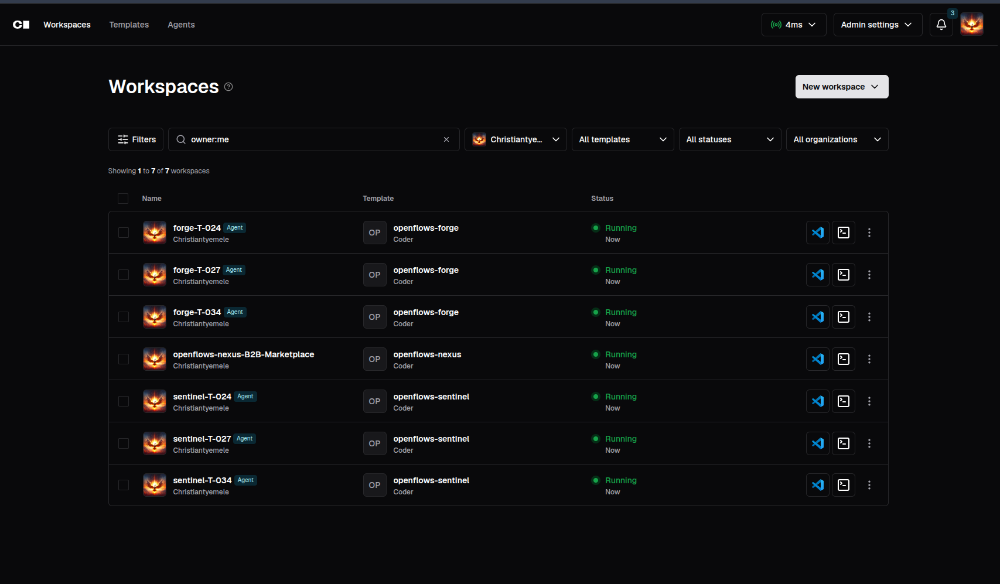

# OpenFlows

Turn GitHub issues into reviewed pull requests with a self-hosted AI development team.

<p align="center">
  <a href="https://github.com/The-AgenticFlow/openflows/actions/workflows/ci.yml"></a>
  <a href="https://github.com/The-AgenticFlow/openflows/stargazers"></a>
  <a href="https://github.com/The-AgenticFlow/openflows/graphs/contributors"></a>
  <a href="LICENSE"></a>
</p>

[Quickstart](#quickstart) · [Deployment](#deployment) · [How it works](#how-it-works) · [Contribute](#contribute) · [Documentation](#documentation) · [Website](https://openflows.dev)

<p align="center">
  <a href="#deployment"></a>&nbsp;&nbsp;&nbsp;&nbsp;
  <a href="#deployment"></a>&nbsp;&nbsp;&nbsp;&nbsp;
  <a href="#deployment"></a>&nbsp;&nbsp;&nbsp;&nbsp;
  <a href="#deployment"></a>
</p>
<p align="center"><sub>Docker on cloud VMs today · Hosted Kubernetes deployment in progress</sub></p>



OpenFlows coordinates AI agents inside [Coder](https://coder.com) workspaces. A controller assigns work, checks plans before coding begins, sends changes through review and CI, and recovers interrupted runs. Coder provides the workspaces and model access; OpenFlows manages the delivery workflow.

- **From issue to merge:** agents plan, implement, review, and merge changes after the required checks pass.
- **Review before code:** the reviewer approves the implementation plan before the builder starts.
- **Run on your infrastructure:** Coder hosts the workspaces, while OpenFlows keeps coordination and audit records in its shared store.
- **Serve multiple repositories:** each tenant has its own repository binding, controller workspace, and Redis namespace.

## Quickstart

You need Docker, `curl`, `python3`, access to a GitHub repository where you can install the OpenFlows App, and an API key for a supported model provider. Building from source also requires Rust.

From a checkout of this repository, run:

```bash
./scripts/setup.sh owner/repo --binary
```

Use `--compose` for published container images or `--source` to build from this checkout. The setup script starts the local services, opens the Manager at <http://localhost:3002> to connect GitHub, configures your model, and creates the workspace templates and repository tenant. It can be rerun after an interrupted setup.

Then open an issue in the connected repository. OpenFlows will pick it up and work toward a reviewed pull request. Check the local Coder dashboard at <http://localhost:7080> or run `./scripts/prod.sh doctor` to inspect the installation.

For installation modes, platform requirements, and the complete walkthrough, see the [quick start guide](quick_start.md). For upgrades and troubleshooting, see the [setup reference](docs/setup-reference.md).

## Deployment

OpenFlows is designed to run on infrastructure you control. The deployment path depends on the workspace backend and the isolation you need:

| Environment | Current path |
| --- | --- |
| **Local machine or single cloud VM** | Run the Docker-based setup above. It brings up Coder, the Manager, Redis, and workspaces on one host. This is the working development and evaluation path, including on a Docker-capable VM in AWS, Azure, Google Cloud, or another provider. It is not a public multi-tenant production deployment. |
| **AWS with Kubernetes (EKS)** | The hosted architecture specifies Kubernetes workspaces, separate staging and production environments, workload IAM, and AWS Secrets Manager. The shipped role templates still create Docker workspaces, so this path is not yet validated for production. |
| **Other Kubernetes providers** | The architecture is intended to support other managed or self-managed clusters. A non-AWS hosted secret-store adapter and Kubernetes workspace templates are still required before that path is supported. |

The [operator deployment guide](docs/implementation/centralized-deployment/operator-deployment.md) explains the deployment profiles. See the [portable workspace runtime design](docs/architecture/portable-workspace-runtime.md) for the Kubernetes architecture and the [AWS runbook](docs/implementation/centralized-deployment/operator-production-runbook.md) for its prerequisites and release gates.

## How it works

```text
GitHub issue → NEXUS assigns → FORGE plans → SENTINEL approves the plan
             → FORGE implements → SENTINEL reviews → VESSEL checks CI and merges
```

| Agent | Responsibility |
| --- | --- |
| **NEXUS** | Coordinates the run and recovers stalled work. |
| **FORGE** | Implements the approved plan and opens a pull request. |
| **SENTINEL** | Reviews the plan and code, including security and tests. |
| **VESSEL** | Watches CI, resolves merge conflicts, and merges approved work. |
| **LORE** | Maintains documentation and project history when enabled. |

OpenFlows asks for human input when a decision needs it. The full design is in the [system architecture](docs/architecture/openflows-system-architecture.md).

## Contribute

You can help improve what each agent knows and how it works. The separate [workspace-runtime repository](https://github.com/The-AgenticFlow/workspace-runtime) owns the instructions, skills, commands, hooks, and standards for NEXUS, FORGE, SENTINEL, VESSEL, and LORE. Contribute agent-specific knowledge under [`roles/<role>/`](https://github.com/The-AgenticFlow/workspace-runtime/tree/main/roles), or knowledge shared by every agent under [`shared/`](https://github.com/The-AgenticFlow/workspace-runtime/tree/main/shared). Follow its [contribution guide](https://github.com/The-AgenticFlow/workspace-runtime/blob/main/CONTRIBUTING.md) when opening a pull request.

## Documentation

| Guide | Use it for |
| --- | --- |
| [Quick start](quick_start.md) | Prerequisites and first run. |
| [Setup reference](docs/setup-reference.md) | Configuration, upgrades, and troubleshooting. |
| [System architecture](docs/architecture/openflows-system-architecture.md) | Components and workflow. |
| [Controller](docs/architecture/openflows-controller.md) | Orchestration and recovery. |
| [Worker workspaces](docs/architecture/openflows-worker-workspace.md) | Workspace setup and agent execution. |
| [Shared store](docs/architecture/openflows-redis-shared-store.md) | State and tenant isolation. |
| [A2A verification](docs/architecture/openflows-a2a-relay.md) | Delegated acceptance tests. |

## Support and security

[Open an issue](https://github.com/The-AgenticFlow/openflows/issues) for bugs and feature requests. To report a vulnerability, follow the [security policy](SECURITY.md).

## License

[MIT](LICENSE).
