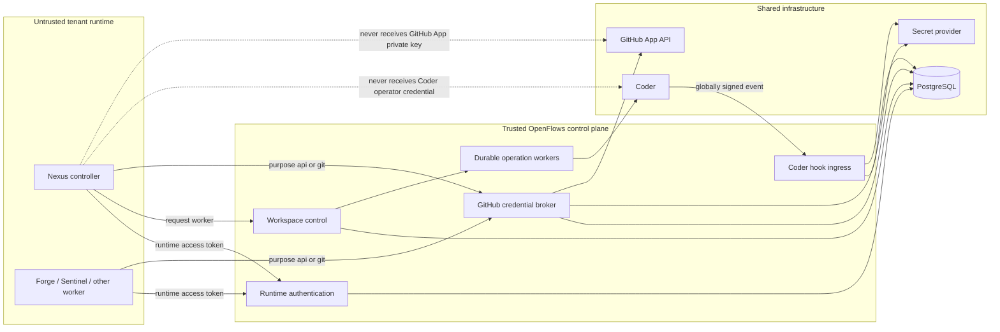
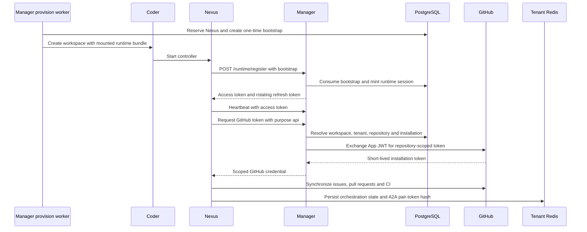
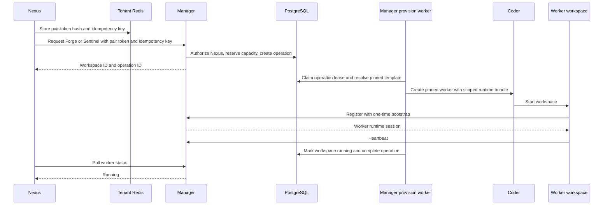
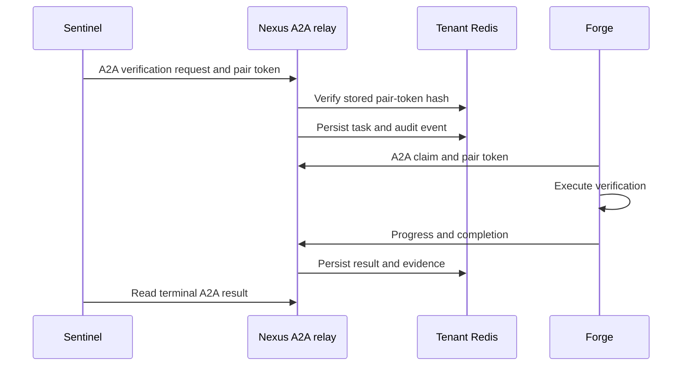
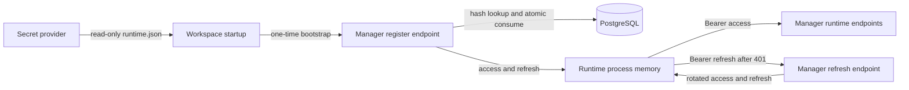
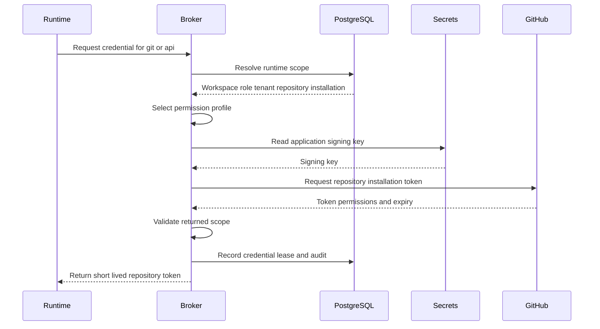
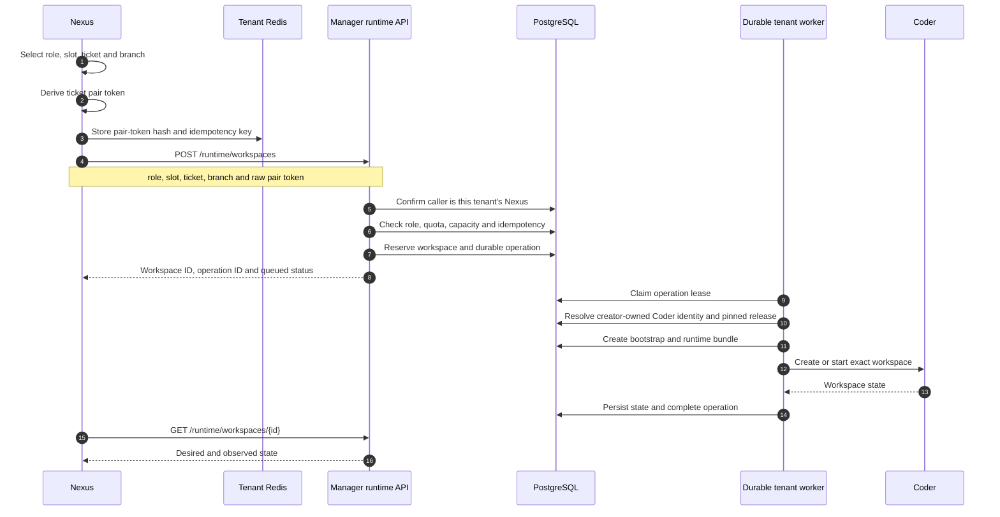
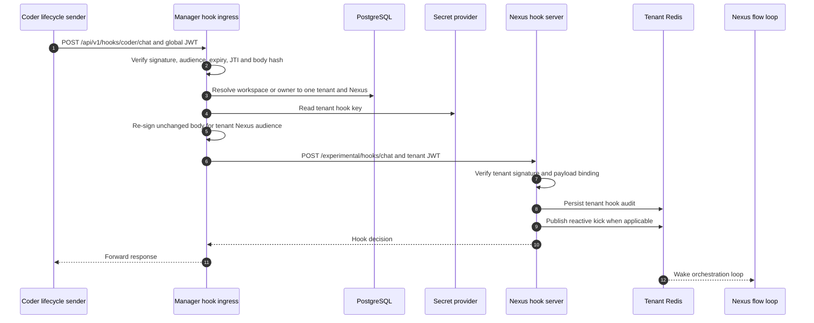
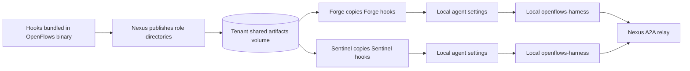
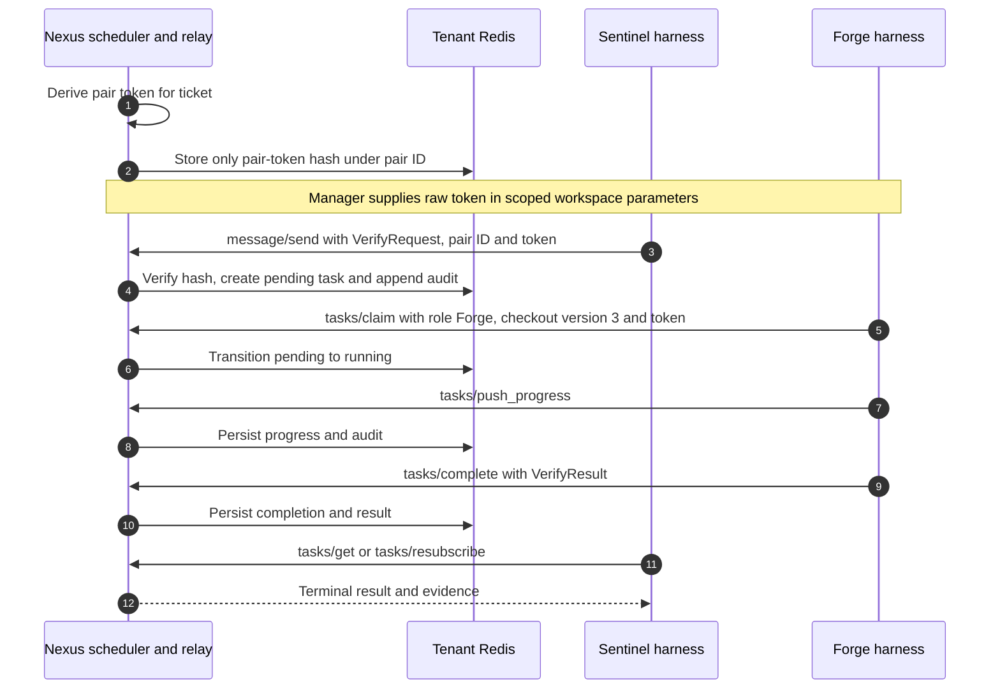

# Manager-Mediated Runtime Architecture

## Purpose

This document explains the behaviour introduced when `openflows-manager` became the authority between OpenFlows runtimes and shared infrastructure. It does not repeat product onboarding or the general platform architecture. It focuses on runtime identity, token rotation, credential brokering, hook delivery, workspace control, and agent-to-agent (A2A) communication.

The broader system is described in [OpenFlows system architecture](openflows-system-architecture.md). This is the behavioural view of the hosted runtime.

## What changed with the Manager

In the hosted model, a workspace is a narrowly scoped runtime principal. It does not hold broad Coder or GitHub authority.



The Manager is not a proxy for every byte exchanged by agents. It is the authority for identity, scope, credentials, provisioning, and lifecycle ingress. Tenant-local coordination remains in the tenant runtime plane.

## Complete runtime sequence

The complete flow has three consecutive phases. They are separated below so
the diagrams remain readable and render correctly in narrow documentation
previews.

### Phase 1: Nexus bootstrap and repository access



### Phase 2: Manager-mediated worker creation



### Phase 3: Forge and Sentinel A2A verification



There are three distinct authorities:

1. **Manager authority** controls runtime identity, credentials, worker creation, and scope.
2. **Nexus authority** controls tenant orchestration, ticket assignment, A2A pairing, and agent coordination.
3. **Coder authority** creates and runs the execution environments requested by the Manager.

## Runtime identity and tokens

### Initial runtime bundle

The Manager prepares a workspace-specific `runtime.json` and mounts it into the Coder workspace. It contains the immutable workspace and tenant IDs, Manager URL, one-time bootstrap token, tenant Redis URL and namespace, and tenant hook key and URL.

It does not contain a GitHub App private key, Coder operator token, Manager database credential, or reusable platform credential.



| Credential | Purpose | Storage and lifetime | Reuse |
|---|---|---|---|
| Bootstrap token | Establish the first session for one workspace | Raw value in mounted bundle; hash in PostgreSQL; short-lived | Single use |
| Access token | Authenticate normal runtime API calls | Process memory; hash in PostgreSQL; short-lived | Reused until rejected |
| Refresh token | Rotate the runtime session | Process memory; hash in PostgreSQL; rotating family with a 24-hour sliding expiry after each successful refresh | Each generation is single use; an inactive family expires after 24 hours |

`RuntimeControlClient` serializes refresh under one mutex. If heartbeat and broker calls both receive `401`, only one consumes the refresh token. The other observes the new access token and retries. A request is retried only once.

### Server-derived scope

The client does not choose its authority. The access-token hash resolves this chain:

```text
runtime credential
  -> workspace and role
  -> tenant
  -> OpenFlows organization
  -> GitHub connection generation
  -> repository
  -> Coder owner and pinned release
```

Every privileged runtime action checks this chain. Changes to workspace, tenant, connection, or credential generations invalidate stale authority.

### Two kinds of heartbeat

The controller sends a Manager heartbeat every 30 seconds; worker runtimes also heartbeat. This updates control-plane liveness in PostgreSQL. Agent coordination heartbeats in tenant Redis are separate: Manager heartbeat answers whether the managed runtime is authenticated and alive, while Redis heartbeat helps Nexus determine whether an assigned agent is progressing.

## Credential broker

A runtime asks only for purpose `git` or `api`, never for arbitrary repository IDs or permissions.



The broker provides:

- **secret containment:** only Manager reads the App private key;
- **server-derived scope:** role and purpose select permissions;
- **short exposure:** workspaces receive only expiring installation tokens;
- **revocation evidence:** the lease records a fingerprint, expiry and generation values.

Nexus uses `api` to synchronize issues, pull requests, and CI. Worker startup uses `git` for clone/fetch/push and configures `gh` with the installation identity. Hosted commits therefore use the GitHub App bot rather than the signed-in human's OAuth identity.

## Manager-mediated worker control

Nexus decides that a worker is needed; Manager decides whether it is authorized and how it is provisioned.



The pair token is delivered into the worker definition for ticket-specific A2A authentication. It is not a Manager token. The stable idempotency key prevents duplicate workspaces. Database operation leases let another Manager replica reclaim work after a process or node crash.

## The two hook systems

The term “hooks” covers two different systems.

### Coder lifecycle HTTP hooks

Coder lifecycle/chat events cross a trust boundary and enter through Manager.



The global Coder signature proves the event source. Manager then resolves the workspace to the tenant and converts that trust into a tenant-specific signature. Coder cannot select a tenant merely by URL, and one tenant cannot forge another tenant's event.

### Agent CLI hooks inside workspaces

These are shell scripts used by agent clients. They are distributed artifacts, not Coder HTTP callbacks.



Nexus publishes role-specific hook directories before workers are dispatched. Startup copies only the current role's hooks and generates settings from scripts that exist. These hooks coordinate the local agent and harness; they grant no infrastructure authority and cannot bypass Manager runtime authorization.

## A2A behaviour

A2A is the tenant-local verification protocol between Sentinel and Forge, hosted by Nexus. Manager establishes and provisions the participants but is not on the A2A hot path.



- The pair ID identifies the ticket relationship; the pair token proves participation.
- Runtime and pair tokens are not interchangeable.
- Only Forge may claim the verification task, with the expected checkout protocol version.
- Tasks, results, and audit entries are mirrored to Redis so relay state survives Nexus restart.
- Redis ACL credentials and an immutable namespace prevent cross-tenant A2A access.

## Who talks to whom

| Caller | Callee | Authentication | Data | Purpose |
|---|---|---|---|---|
| Workspace startup | Manager register | One-time bootstrap | Bootstrap token | Establish runtime session |
| Nexus or worker | Manager runtime API | Access/refresh family | Heartbeat, worker commands, credential purpose | Privileged operations with derived scope |
| Manager provision worker | Coder API | Server-held operator credential | Template and workspace operations | Keep Coder authority out of workspaces |
| Manager broker | GitHub App API | Server-held App key/JWT | Exact repository and permissions | Mint short-lived credentials |
| Nexus or worker | GitHub | Installation token | Git and API operations | Repository work without personal tokens |
| Coder | Manager hook ingress | Global hook JWT | Lifecycle event | Authenticate source and resolve tenant |
| Manager hook ingress | Nexus hook server | Tenant hook JWT | Unchanged lifecycle event | Tenant delivery and policy response |
| Runtimes | Tenant Redis | Tenant Redis ACL and namespace | Orchestration, heartbeats, A2A and hook state | Tenant-local durable coordination |
| Sentinel/Forge | Nexus A2A relay | Ticket pair token | Tasks, progress and results | Agent verification protocol |
| Nexus publisher | Shared artifacts | Filesystem boundary | Hooks, personas and skills | Deterministic worker assets |

## State and secret ownership

| System | Authoritative data |
|---|---|
| PostgreSQL | Ownership, workspace roles, tenant/repository scope, operations and leases, credential hashes, GitHub leases, generations |
| Secret provider | Raw bootstraps, Redis passwords, hook keys, GitHub App key, workspace bundles |
| Redis | Tenant orchestration, agent heartbeats, worker slots, A2A hashes/tasks/results/audit, hook audit and reactive kicks |
| Coder | Workspace/build/agent execution state and runtime bundle mounting |
| Workspace memory | Current access/refresh pair and short-lived GitHub token |
| Shared artifacts | Published role hooks and deterministic runtime assets, never authorization state |

## Failure and recovery

| Failure | Behaviour |
|---|---|
| Access token expires | First `401` causes one serialized refresh and one retry |
| Refresh family expires | Runtime requires a new bootstrap/session |
| Manager worker dies during provisioning | Database lease expires; another replica reclaims the operation |
| Nexus repeats a worker request | Idempotency key returns/reuses the existing operation and workspace |
| Connection or workspace generation changes | Stale runtime scope or broker lease is rejected |
| Hook workspace cannot be resolved | Manager rejects the event instead of guessing a tenant |
| Nexus hook server is unavailable | Manager reports relay failure; it does not reroute the event |
| Nexus restarts | Orchestration and A2A state are recovered from tenant Redis |
| A2A token does not match | Relay rejects the method before mutating task state |
| Worker stops heartbeating | Nexus marks assignment unhealthy; Manager retains durable workspace state |

## Current boundaries

- Manager runtime credentials are not Redis passwords, A2A tokens, Coder tokens, or GitHub credentials.
- Manager is on workspace provisioning and lifecycle-hook paths, but not between each Forge/Sentinel A2A message.
- Broker single-flight coalescing is currently process-local; distributed single-flight remains an infrastructure improvement.
- Manager must reach the Nexus hook server, and workers must reach the Nexus A2A relay.
- Template releases are immutable; runtime and hook changes require a new release and workspace update/rebuild.

## Code map

| Behaviour | Implementation |
|---|---|
| Runtime routes | `crates/openflows-manager/src/routes/runtime.rs` |
| Credential issuance and scope | `crates/openflows-manager/src/runtime/credentials.rs` |
| Runtime bundles and tenant credentials | `crates/openflows-manager/src/runtime/tenant.rs` |
| GitHub broker | `crates/openflows-manager/src/runtime/broker.rs` |
| Managed worker authorization | `crates/openflows-manager/src/runtime/workspaces.rs` |
| Durable workspace provisioning | `crates/openflows-manager/src/provisioning/tenant_worker.rs` |
| Coder hook ingress and relay | `crates/openflows-manager/src/routes/coder_hooks.rs` |
| Nexus Manager client | `crates/agent-nexus/src/runtime_control.rs` |
| Nexus scheduling | `crates/agent-nexus/src/lib.rs` |
| A2A protocol | `crates/agent-nexus/src/a2a/http_server.rs`, `crates/agent-nexus/src/a2a/routing.rs` |
| Nexus hook consumer | `crates/agent-nexus/src/hooks/server.rs` |
| Controller composition | `binary/src/bin/agentflow.rs` |
| Workspace startup | `crates/coder-client/templates/openflows-*/main.tf` |
