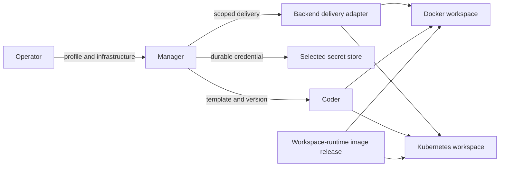
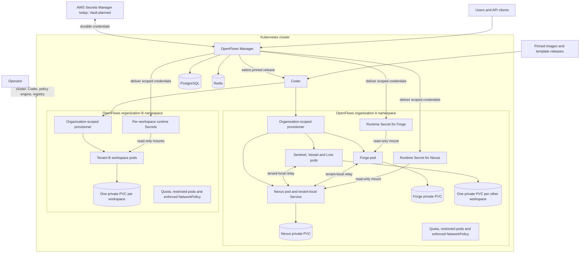
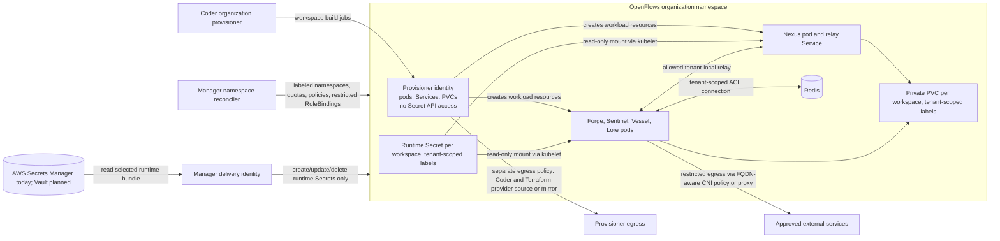

# Portable workspace runtime

This document defines the deployment and workspace ownership contract. The [Manager-mediated runtime architecture](manager-hosted-runtime-architecture.md) remains the source for runtime identity and API behavior.

The workspace runtime is released separately from the OpenFlows application. A dedicated workspace-runtime repository is the source of truth for the workspace image, shared bootstrap, role instructions and personas, skills, commands, standards, hooks, tool configuration, and required workspace binaries. OpenFlows selects and consumes an immutable runtime release; it does not build or silently assemble those assets.

## Why this change is needed

Manager can select a `kubernetes` provisioner, but all five Coder role templates currently create Docker containers and volumes. They also assume Docker network names and host file mounts. Hosted configuration currently requires AWS Secrets Manager, while the template treats its secret reference as a filesystem path. Those combinations cannot start a hosted workspace. The local Docker path remains valuable and must continue to work.

## Four independent choices

| Choice | Local default | Hosted default | Contract |
| --- | --- | --- | --- |
| Deployment profile | Local | Hosted | Provides safe defaults and validates capabilities; it is not a cloud provider. |
| Workspace backend | Docker | Kubernetes | Supplies Coder template variants, networking, storage, and secret mounts. |
| Durable secret store | Filesystem | AWS Secrets Manager | Holds operator and workspace credentials. AWS Secrets Manager is the only hosted provider supported today. |
| Workspace secret delivery | Restricted file mount | Scoped Kubernetes Secret volume | Makes one workspace's credential bundle available at `/run/openflows/runtime.json`, independently of the durable store. |

Non-AWS hosted secret storage is a planned capability. Vault is the selected non-AWS provider, but its adapter does not exist yet and hosted configuration currently accepts only AWS Secrets Manager. Supporting Vault requires implementing the `SecretProvider` get/put/replace/delete operations and changing hosted configuration validation to allow the explicit Vault provider. Filesystem and in-memory stores remain invalid for shared hosting. The operator must supply a cluster, Coder, PostgreSQL, Redis, ingress, image registry access, network policy enforcement, and credentials. EKS is one cluster implementation, not a runtime requirement. The non-AWS Kubernetes release gate cannot pass until the Vault adapter and configuration change are implemented and verified.

### Hosted Kubernetes topology

Each namespace maps to one OpenFlows organization and its Coder organization. Tenants within an organization share that namespace, so OpenFlows enforces tenant separation with scoped runtime credentials, labels, service accounts, network policies, private workspace PVCs, and tenant resource budgets. Each pod has its own workspace storage; plans and handoffs use the explicit exchange contract rather than a shared volume.

### Hosted privilege and traffic boundaries

The Manager namespace reconciler and Secret delivery identity are separate. Workspace pods have no Kubernetes API token by default; where a workload needs Kubernetes API access, it receives a tenant-specific service account with only the required permissions. Network policy denies cross-tenant traffic and blocks instance metadata; provisioner downloads use their own egress policy. The provisioner is scoped to the OpenFlows organization's namespace through its Coder organization configuration. OpenFlows Manager maps multiple OpenFlows tenants within that organization namespace and applies tenant labels and controls.

## Ownership

| Owner | Responsibilities |
| --- | --- |
| Operator | Provision cluster or Docker host, Coder, databases, Redis, ingress, registry access, network enforcement, workload identity, and chosen secret store. Provide pinned release configuration. |
| Manager | Validate profile capabilities; select a compatible role/backend release; create tenant and workspace records; prepare, rotate, and retire credentials; reconcile delivery and tenant boundaries; orchestrate lifecycle and report actionable failures. |
| Coder and its provisioner | Apply the selected versioned template, create/start/stop/destroy workspaces, and report build state. Each OpenFlows organization maps to one Coder organization with its organization-scoped provisioner key. The provisioner receives permissions for that organization's Kubernetes namespace; OpenFlows enforces tenant scope inside that namespace. |
| Terraform role template | Describe backend resources: container or pod, private storage, service discovery, mounts, and Coder agent wiring. It must not contain long role bootstrap programs or secret values. |
| Workspace-runtime release | Own and publish the pinned image, shared bootstrap, curated role assets, and required workspace binaries. Role-specific configuration selects Nexus, Forge, Sentinel, Vessel, or Lore. |

Resource ownership must be exclusive: Manager or an operator component owns organization namespace and quota reconciliation; Manager's separate delivery identity owns runtime Secret reconciliation; Coder/Terraform owns workspace pod, service, and PVC lifecycle. A policy must have one owner before either reconciler writes it. Manager records resource identifiers for retry and cleanup; organization and tenant labels identify resources and orphans.

## Workspace contract

Each workspace release has a role, backend, parameter schema version, workspace-runtime release, full image reference and digest, architecture, and immutable template digest. Manager checks this tuple against the selected provisioner and cluster capability before creating a workspace. An existing workspace remains pinned to its selected tuple until an explicit migration. The workspace-runtime image exposes one bootstrap entrypoint, a credential file path, role command, readiness signal, and documented persistent paths. Local development bind mounts are optional and never required by a release.

Startup is: (1) create the organization namespace and per-workspace credential bundle; (2) Coder starts the workspace from the pinned image; (3) bootstrap validates the one-use token and registers with Manager to establish its runtime session; (4) bootstrap requests a short-lived, repository-scoped GitHub installation token from Manager, obtains the requested revision from the tenant seed, prepares private storage, installs versioned role assets, and discards the token; (5) the role starts and reports readiness. Registration precedes repository access because the GitHub broker requires an authenticated runtime session. This flow is the same for every repository. Failures are visible to Manager and retryable without creating duplicate workspaces. Nexus exposes a tenant-local relay address; workers receive that address through backend-neutral configuration. The role never receives the Coder operator credential or GitHub App private key.

The credential bundle contains a one-use bootstrap token plus Redis and hook credentials. Registration consumes the token; it does not imply the whole mounted bundle can be deleted. Rotation updates the durable store and delivery representation, then confirms the runtime has adopted the new generation. A process restart may reuse its valid runtime session; a rebuilt workspace needs a fresh bootstrap. Manager restart reconciles desired state from durable records. Deletion revokes sessions and credentials, destroys Coder workspaces, and removes delivered secrets, storage, and tenant resources after dependent workspaces are gone. Cleanup is idempotent and retries orphaned resources.

Each workspace has private persistent storage. Repository source is cached only within its owning tenant to avoid a full GitHub fetch for every role workspace. Nexus maintains one tenant-local golden clone, refreshed with a short-lived repository-scoped installation token brokered by Manager. Workers obtain the requested revision from that seed through a read-only mount where supported, or through Nexus's authenticated tenant-local seed-transfer endpoint, then materialize it into their own private workspace PVC. The token is not stored in the seed or exposed to workers. This cache is never shared across tenants; the organization namespace and tenant-scoped authorization enforce that boundary. A shallow fetch is used when it can satisfy the requested revision, with deeper history only when required.

The current Docker templates share `/home/coder/.openflows/artifacts`; the migration accounts for these consumers:

| Role | Current shared-volume reads/writes | Replacement |
| --- | --- | --- |
| Nexus | Refreshes and seeds `artifacts/repo`; writes orchestration assets and role instructions under `artifacts/orchestration` and plugin assets under `artifacts/plugin`; exposes the directory through `ARTIFACTS_DIR`. | Retains a tenant-local golden repository clone as a read-only seed for workers. Static role assets and binaries come from the pinned workspace-runtime release. Dynamic orchestration state stays in Manager and tenant-scoped Redis. |
| Forge | Reads `artifacts/repo` as a workspace seed, `artifacts/orchestration` for persona, skills, commands, and standards, and `artifacts/plugin/hooks/<role>` for hook scripts. | Gets the requested repository revision from the tenant-local seed: use a read-only shared mount where supported, otherwise copy it over Nexus's authenticated tenant-local seed-transfer endpoint. Materialize it in private workspace storage. Bootstrap installs static role assets and hooks from the pinned workspace-runtime release. |
| Sentinel | Reads `artifacts/repo` as a workspace seed and `artifacts/orchestration` for persona, skills, commands, and standards. | Gets the requested repository revision from the tenant-local seed: use a read-only shared mount where supported, otherwise copy it over Nexus's authenticated tenant-local seed-transfer endpoint. Materialize it in private workspace storage. Bootstrap installs static role assets from the pinned workspace-runtime release. |
| Vessel | Reads `artifacts/repo` as a workspace seed and `artifacts/orchestration` for persona, skills, commands, and standards. | Gets the requested repository revision from the tenant-local seed: use a read-only shared mount where supported, otherwise copy it over Nexus's authenticated tenant-local seed-transfer endpoint. Materialize it in private workspace storage. Bootstrap installs static role assets from the pinned workspace-runtime release. |
| Lore | Reads `artifacts/repo` as a workspace seed and `artifacts/orchestration` for persona, skills, commands, and standards. | Gets the requested repository revision from the tenant-local seed: use a read-only shared mount where supported, otherwise copy it over Nexus's authenticated tenant-local seed-transfer endpoint. Materialize it in private workspace storage. Bootstrap installs static role assets from the pinned workspace-runtime release. |

The immutable role assets no longer depend on that volume. The Manager serves the bundle of the release it runs: `GET /api/v1/runtime/artifacts` returns a deterministic gzipped tar and reports its sha256 in the `x-artifact-digest` header, and `GET /api/v1/runtime/artifacts/{digest}` returns that bundle only. A hosted workspace fetches and verifies it at bootstrap with `openflows-harness artifacts fetch`, which pins the digest of the bundle compiled into the harness, so a Manager serving a different bundle is refused instead of mixing assets with code. A worker therefore never reads a half-published bundle, and never runs a bundle other than its own. The same tree is what the Nexus workspace writes to the volume, because both come from one definition in `crates/workspace-assets`, so the two delivery paths cannot drift. The volume keeps one job in local mode: the tenant-local repository seed. Hosted workspaces mount no shared storage at all, since each one installs the bundle and clones the repository with its own brokered credential.

Plans and handoffs use the existing `openflows-harness` workflow, which accesses Redis directly from workspace pods with tenant-scoped credentials and an immutable tenant namespace. This is existing behavior, not a new Manager API. Network policy must allow workspace-to-Redis connections; Redis ACLs and namespace scoping prevent a workspace from accessing another tenant's coordination data. Preserve existing in-workspace paths during migration where practical.

Nexus keeps the golden clone on its private PVC. Workers obtain the requested revision using a read-only shared seed mount when the backend supports one; otherwise they copy it from Nexus through an authenticated, tenant-local transfer endpoint. The endpoint authorizes the workspace against its tenant and repository, serves only the requested revision, and supports integrity/version checks and retry. Workers materialize the result on their own private PVC. RWX is an optional optimization, never a cluster prerequisite; the transfer path is the portable fallback.

## Networking and isolation

Docker local is a trusted, single-host evaluation profile. Hosted Kubernetes uses one namespace per OpenFlows organization, matching its Coder organization and provisioner key. Multiple OpenFlows tenants share that namespace. OpenFlows enforces tenant-level separation through tenant-scoped workload identity and credentials, resource labels, private PVCs and Secrets, default-deny tenant network policies, and per-tenant resource budgets. Readiness probes verify allowed same-tenant connectivity and denied cross-tenant traffic and resource access. If the cluster cannot enforce the required policy, shared hosting fails readiness.

Pods share a host kernel. For workloads treated as hostile code, an operator must assess sandboxed pods or VM-level separation; namespace and NetworkPolicy are not a hard isolation guarantee. This is a deployment security decision, not a reason to hardcode EKS into OpenFlows.

## Decisions and tradeoffs

| Choice | Direction | Cost or limit |
| --- | --- | --- |
| Separate Docker and Kubernetes templates | Five variants per backend, consuming the independently released workspace-runtime image/bootstrap contract | Two infrastructure implementations need compatibility tests; avoids duplicating role startup logic. |
| Explicit artifact delivery | Preferred after dependency inventory | Requires versioning and retry logic; avoids mandatory RWX storage. Use RWX only for proven live sharing. |
| Kubernetes Secret delivery | Initial generic Kubernetes adapter | Secret exists in cluster storage and needs encryption at rest, narrowly scoped RBAC, rotation, and cleanup. External Secrets or CSI can be later adapters where justified. |
| Durable secret store | AWS Secrets Manager is the only hosted provider supported today; Vault is planned as the non-AWS provider | Vault requires a `SecretProvider` adapter and hosted configuration validation change before non-AWS hosted deployments are supported. |
| Namespace per organization | Hosted baseline aligned with Coder organization-scoped provisioners | Tenants share the namespace and require explicit OpenFlows-managed network, identity, storage, secret, and resource-budget isolation. |
| VM backend | Optional future backend | Stronger tenant boundary at greater cost and startup time. |

## Binding implementation decisions

These decisions govern the runtime implementation and the separate workspace-runtime integration.

| Concern | Decision and ownership |
| --- | --- |
| Tenant and organization boundary | One namespace per OpenFlows organization; each organization maps to one Coder organization and its provisioner key. OpenFlows tenants are not Coder objects and share the organization's namespace. OpenFlows Manager enforces tenant scope with tenant labels, credentials, workload service accounts, network policies, private PVCs and Secrets, and resource budgets. The operator installs the policy engine. Manager's namespace reconciler has a narrowly scoped ClusterRole for organization namespaces and required namespace, quota, policy, and RoleBinding resources; it may bind only roles it already holds. A separate Manager delivery identity writes runtime Secrets and has no namespace-administration permissions. The organization-scoped provisioner may manage pods, Services, and PVCs in its organization's namespace but cannot read Secrets. No cluster-wide credential reaches a workspace. |
| Pod and network isolation | Enforce the Kubernetes `restricted` Pod Security Standard with organization namespace labels; run non-root, disable `automountServiceAccountToken` by default, prohibit privileged containers and host mounts, and set resource requests and limits. Tenant-specific service accounts are explicit exceptions only where workloads require Kubernetes API access. Deny access to cloud instance metadata (including `169.254.169.254`) through node configuration or egress controls. Apply default-deny ingress and egress with tenant labels/selectors. Permit required same-tenant relay and tenant-scoped workspace-to-Redis flows. Redis ACLs and immutable tenant namespaces scope coordination data. Standard NetworkPolicy cannot allow hostnames; the operator must provide a CNI with FQDN policy support or an egress proxy for GitHub and registry access. Provisioner egress to Coder and Terraform provider sources or a mirror uses a separate policy from workspace pods. Readiness verifies enforcement with positive same-tenant and negative cross-tenant probes and refuses shared hosting on failure. |
| Runtime credentials | Manager reads the selected durable store and creates one Kubernetes Secret per workspace, labeled with organization and tenant IDs, mounted read-only at `/run/openflows/runtime.json`. Encrypt Kubernetes Secrets at rest; on EKS use KMS envelope encryption. RBAC denies Secret reads to the Coder provisioner and workspace identities; only the delivery identity may create, update, or delete these Secrets. Pods receive the mounted data through the kubelet and cannot use Kubernetes API credentials to read other Secrets. The template receives only the Secret's name, never its value. Manager owns generation, rotation, revocation, and deletion. Registration consumes the bootstrap token, while Redis and hook credentials remain mounted. A rebuild gets a new bootstrap token and Secret generation; restart reuses a valid runtime session or obtains a fresh token. Manager reconciliation restores delivery after its own restart. |
| Artifact delivery | Package immutable role instructions and hooks with the pinned runtime release and copy them to the existing in-workspace paths at bootstrap. Nexus maintains one tenant-local golden repository clone on its private PVC, refreshed with a short-lived repository-scoped installation token brokered by Manager. Workers get a requested revision through an optional read-only seed mount or an authenticated tenant-local transfer endpoint, then materialize it on their own private PVC. The token is never placed in the seed or delivered to workers; use shallow fetches when sufficient. The endpoint verifies tenant, repository, and revision scope and supports integrity checks and retries. Plans and handoffs use the existing `openflows-harness` Redis workflow; workspace pods connect directly using tenant-scoped credentials and network policy permits only the necessary Redis access. RWX is optional and not required for correctness. |
| Release compatibility | The workspace-runtime project publishes an immutable release manifest containing the runtime release, role assets, image reference and digest, supported architecture, bootstrap contract, and compatible template/schema versions. OpenFlows adds the backend and template digest, resolves the whole tuple before creating a workspace, and rejects incomplete or mismatched releases. Existing workspaces keep their selected tuple; upgrades create a new workspace and migrate only explicitly supported data. Rollback selects the previous immutable tuple and valid snapshot. |
| Persistent storage | One ReadWriteOnce PVC per workspace, labeled with organization and tenant IDs and mounted at the same private workspace path used by Docker. Coder owns pod, Service, and PVC creation and deletion; Manager owns organization namespace and delivery Secret lifecycle. Tenant deletion removes that tenant's workspaces and PVCs while retaining the organization namespace; organization deletion removes the namespace after all tenants and dependents are gone. All steps are idempotent and resource IDs are recorded for retries. |
| Portable secret store | AWS Secrets Manager is the hosted provider today. Vault is the planned non-AWS provider. Its implementation must add the `SecretProvider` get/put/replace/delete adapter and update hosted configuration validation to accept the explicit Vault selection. Runtime bundle values must not appear in Coder parameters or Terraform state. Coder agent authentication tokens may be present in pod configuration or Terraform state depending on the Coder integration; protect that state with restricted access and encryption, and keep those tokens distinct from the runtime credential bundle. Selecting an unavailable configured provider fails clearly. |

The tenant boundary consists of namespace-scoped API permissions, private PVCs and Secrets, enforced network policy, tenant-scoped application credentials, and runtime restrictions together. A namespace name by itself does not supply that boundary. For hostile code requiring a stronger boundary than a shared kernel, the operator selects sandboxed pods or a VM backend before admitting that workload.

## Migration and release gates

Publish the workspace-runtime repository and its first compatible release before switching template consumers. Extend OpenFlows release manifests and Manager selection so each workspace records both the workspace-runtime release and the OpenFlows template release. Add credential delivery and artifact contracts, followed by Kubernetes templates. Bring up Nexus and Forge together because that tests relay, secrets, and worker artifacts; then add the remaining roles. Do not mutate an existing Docker workspace into a Kubernetes one in place. Create a new workspace from compatible releases, migrate only explicitly supported persistent data, verify readiness, then retire the old workspace. Roll back by selecting the previous pinned pair and restoring its still-valid workspace or data snapshot.

The operator provides a CSI snapshot controller for PVC snapshot and restore. Set per-tenant resource requests and limits and enforce a tenant resource budget appropriate to cluster capacity. The acceptance suite includes a quota-exhaustion case and verifies that admission rejects a tenant/workspace that exceeds its budget with a clear error.

The release gate is a common acceptance suite on local Docker, generic non-AWS Kubernetes, and EKS staging: create a tenant, run all five roles and a representative task, test restart/rotation/rebuild/delete and snapshot restore, verify no cross-tenant reachability or secret access, verify quota rejection, and record image/template digests. Until these gates pass, the Kubernetes design is prospective rather than production-ready.
